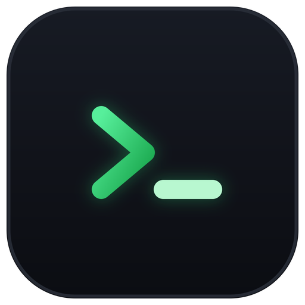

<div align="center">



# Mesa

**An open-source AI agent workbench. The AI does the work, Mesa manages the environment and the review gates, you make the calls.**

One desktop app for the connections, chats and terminals of nine coding agents — with worktrees and a PR loop for coding, and reviewed pipelines for research: reading papers → cleaning data → making figures → writing the manuscript.

<p>
  <a href="https://github.com/Zeta-Techs/mesa/actions/workflows/build.yml"></a>
  <a href="https://github.com/Zeta-Techs/mesa/releases/latest"></a>
  
  <a href="LICENSE"></a>
</p>

<p>
  <a href="../../releases/latest"><b>Download</b></a> ·
  <a href="README.md"><b>中文</b></a> ·
  <a href="CHANGELOG.md"><b>Changelog</b></a>
</p>

</div>

https://github.com/user-attachments/assets/a9a7d744-3622-4427-805e-273a89e9326a

<p align="center"><sub>60 seconds: from a pile of PDFs to an English review, with every citation traceable (on-screen text is in Chinese)</sub></p>

<p align="center"></p>

> The app UI and the full documentation are in Chinese. This page is a short English overview.

## Why Mesa

- **One set of keys for nine agents.** Manage API connections and official account logins for Claude Code, Codex, Gemini CLI, Qwen Code, OpenCode, Kimi Code, CodeBuddy Code, Cursor CLI and Grok Build in one place. By default Mesa injects the configuration as environment variables at launch and leaves each CLI's own config files alone. "Set as global default" writes them on request, after a backup.
- **Chat and terminal are the same session.** Chat as in a regular AI client, switch model, reasoning level and permission mode in the composer, and press `⌘⇧T` to see the real terminal underneath. Past local sessions of all nine CLIs can be searched, replayed, resumed, or handed off to the Codex app or Claude desktop.
- **Research pipelines with review gates.** Six templates: literature review, research paper, data analysis, thesis, submission & revision, and LaTeX. Each step runs in an isolated working copy; changes reach your project only after you review them. Searches are logged, and citations may only use keys already in your BibTeX library.

| | Running CLIs in a terminal | With Mesa |
|---|---|---|
| Switching provider or key | Edit each CLI's config or env vars | Pick a connection; gateways are shared across agents |
| Seeing what the AI did | Scroll the terminal | Structured chat view plus the same session's terminal |
| Finding old conversations | Dig through each CLI's folder | One search and replay across nine CLIs |
| AI editing files | Edits land in your project directly | Writing tasks run in an isolated copy, merged after review |
| Cost | Check each provider's dashboard | Totals by project, model and task, with plan quota and gateway balance |

<table>
  <tr>
    <td width="50%"><br/><sub>Connections: API keys and official accounts for nine agents</sub></td>
    <td width="50%"><br/><sub>Research pipeline: stepper, current step, review before merge</sub></td>
  </tr>
  <tr>
    <td><br/><sub>Reader: notes · PDF · terminal</sub></td>
    <td><br/><sub>Usage: plan quota, gateway balance, cost and activity</sub></td>
  </tr>
</table>

## Features

- **Connections**: gateway × binding model, API keys and official accounts side by side, keys stored locally with 0600 permissions and never echoed, a bundled model capability database, one-click CLI install and update.
- **Run page**: chat layer on top of a real xterm.js terminal; file tree, change panel, Monaco preview and editing; inline preview of PDF, docx, pptx, spreadsheets, images, Jupyter notebooks, audio and video; a three-pane reader (notes | PDF | terminal).
- **Sessions**: parses the local session files of all nine CLIs, including ones started outside Mesa; auto titles, archive, Markdown export, session bundles for moving machines.
- **Projects**: research, coding and general work. Coding projects use separate worktrees that merge back or open a PR.
- **Skills & MCP**: one skill library distributed to every CLI, 21 built-in skills; one MCP list, with presets for Consensus, Undermind and Blender.
- **Research extras**: scheduled literature radar, journal metric badges, citation checks, EndNote and Zotero bridges.

## Install

Download from [Releases](../../releases):

| Platform | File |
|---|---|
| macOS, Apple silicon | `Mesa_x.x.x_aarch64.dmg` |
| macOS, Intel | `Mesa_x.x.x_x64.dmg` |
| Windows | `Mesa_x.x.x_x64-setup.exe` (silent install: `setup.exe /S`) |

No Linux build yet. The macOS build is not notarized yet; if macOS says the app is damaged, run `xattr -cr /Applications/Mesa.app`. The Windows installer is not code-signed yet; on the SmartScreen prompt choose **More info → Run anyway**.

## Development

```bash
npm install
npm run tauri:dev      # dev window "Mesa Dev - 热更新", HMR + Rust auto-restart
npm test
cd src-tauri && cargo test
```

See [CONTRIBUTING.md](CONTRIBUTING.md) and [AGENTS.md](AGENTS.md) (Chinese). Security reports: [SECURITY.md](SECURITY.md).

## License & trademarks

[Apache-2.0](LICENSE), with [NOTICE](NOTICE). The license does not grant trademark rights: the "Mesa" name and icon belong to the maintainers. Redistributed modified versions must use a different name and icon; see [TRADEMARKS.md](TRADEMARKS.md). Mesa is not an official product of Claude Code, Codex or any other CLI, and is unrelated to the [Mesa 3D graphics library](https://mesa3d.org/).

Copyright 2026 泽塔前沿科技（杭州）有限公司
